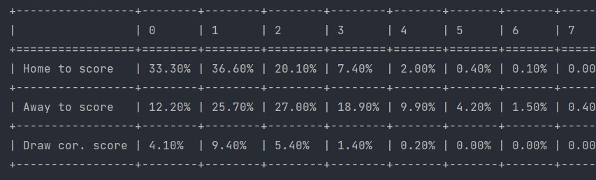

<h1 align="center">Poisson Odds</h1>

<p align="center">
  <a href="https://pypi.org/project/poisson-odds/">
    
  </a>
  
  <a href="https://github.com/nikolaitolmachev/poisson-odds/actions/workflows/tests.yml">
    
  </a>
</p>

A Python library for calculating sports betting probabilities and fair odds using the Poisson distribution.

Poisson Odds calculates **moneyline (1X2), handicaps, and over/under totals** based on team qualities. 
Team qualities can be estimated using expected goals (xG), historical scoring averages, or other performance metrics suitable for modeling scoring rates.

---

## Installation

Install Poisson Odds from [PyPI](https://pypi.org/project/poisson-odds/) using pip:

```bash
pip install poisson-odds
```

**Requirements:** Python 3.11 or newer.

---

## Usage

Initialize the Poisson model with two positive numeric values representing the teams' qualities:

```python
from poisson_odds import Poisson

model = Poisson(1.1, 2.1)
```

### Moneyline (1X2)

Get the fair odds for a home win, draw, and away win:

```python
print(model.moneyline)
```

Output:

```text
1-X-2: 5.291-4.878-1.669
```

### Handicaps

Calculate fair odds for handicap betting markets, including Asian handicaps:

```python
handicaps = model.calculate_handicap_odds_by_poisson()

print(handicaps[1.5])
```

Output:

```text
1.5: 1.582 / 2.717
```

The result shows the handicap line followed by the fair odds for the home and away teams, respectively.

### Totals (Over/Under)

Calculate fair odds for total goals betting markets, including Asian totals:

```python
totals = model.calculate_total_odds_by_poisson()

print(totals[2.75])
```

Output:

```text
Over/Under 2.75: 1.788 / 2.333
```

The result shows the total goals line followed by the fair odds for Over and Under, respectively.

---

## Probability Table

Display the Poisson probability distribution for both teams, including the probabilities of matching scores:

```python
model.print_probability_table_goal_draws()
```



---

## Demo Project

Explore the [Poisson Odds Demo](https://github.com/nikolaitolmachev/poisson-odds-demo), a practical example of using 
the library to analyze NHL betting odds and compare them with probabilities calculated from expected goals (xG).

---

## License

This project is licensed under the MIT License. See the [LICENSE](LICENSE) file for details.
